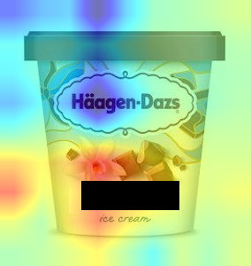
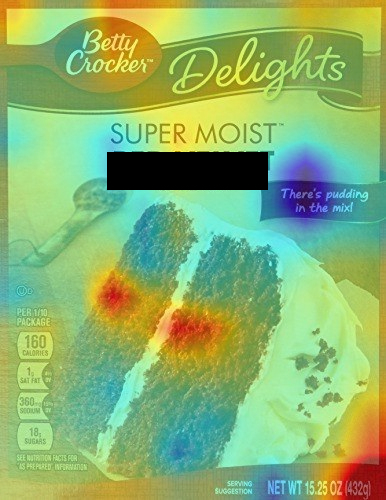
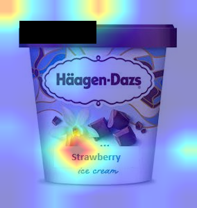
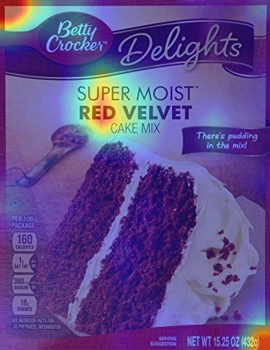
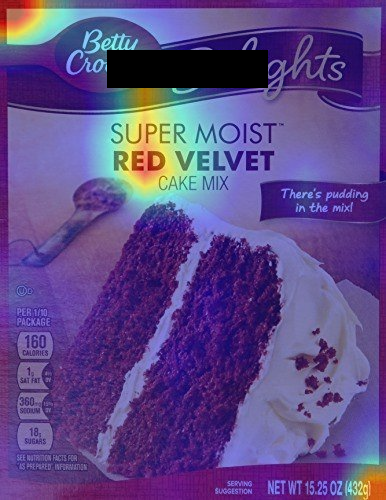
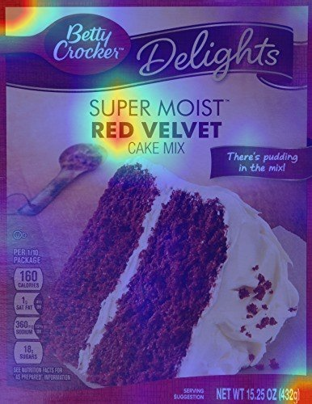
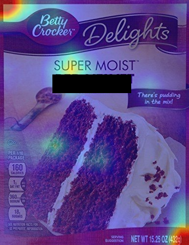
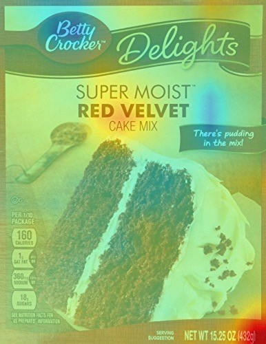
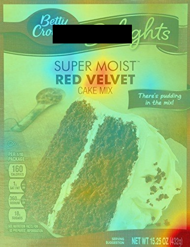

# PA-OPSD: Paired Visual Attention

**Supplementary qualitative visualizations · Post-training comparisons**

This supplement compares **output-only distillation** and the **full PA-OPSD model** on the same images under three input conditions. It includes signed attention-difference maps to make local changes easier to inspect.

The two models share the base model, training data, and output-distillation objective. The additional component in the full model is the **spatial attention loss**.

## At a Glance

The panels below show **full − output-only** after masking critical text. The localized increases appear over remaining image content: the face on the movie poster, the ice-cream imagery, and the cake imagery.

| Movie poster | Ice-cream packaging | Cake packaging |
| :---: | :---: | :---: |
|  |  |  |

**These are attention-redistribution observations, not answer-accuracy results.** Removing critical evidence can make the original answer unidentifiable; a shift toward other content does not imply that the remaining content supports the answer.

## How to Read the Comparisons

**Rows compare models:**

- **Output-only:** output distillation without the spatial attention loss.
- **Full model:** output distillation with the spatial attention loss.
- **Full − output-only:** a signed difference map, not an absolute attention map.

**Columns compare inputs:**

- **Original image:** no masking.
- **Non-critical region masked:** a control input with a non-critical region removed.
- **Critical region masked:** an intervention input with critical text removed.

Both models receive the **same image within each column**. The comparison is paired at the example and input-condition level.

**Difference-map colors:** blue indicates a decrease, green is near zero, and red indicates an increase in the full model relative to output-only. Difference colors have a separate signed interpretation and should not be read as absolute attention. Numerical color ranges are not reported here.

The two models can have similar main hotspots. The signed difference row helps inspect local allocation changes that are less apparent in the first two rows. Open any image to view it at its original resolution.

## Example 1: Movie Poster

This example contains prominent text and a face region. With the critical text masked, the signed difference map shows a localized increase over the remaining face region.

| Model | Original image | Non-critical region masked | Critical region masked |
| :--- | :---: | :---: | :---: |
| **Output-only** |  |  |  |
| **Full model** |  |  |  |
| **Full − output-only** |  |  |  |

## Example 2: Ice-Cream Packaging

This example contains a flavor label and product imagery. With the critical label masked, the signed difference map shows a localized increase over the product imagery on the package.

| Model | Original image | Non-critical region masked | Critical region masked |
| :--- | :---: | :---: | :---: |
| **Output-only** |  |  |  |
| **Full model** |  |  |  |
| **Full − output-only** |  |  |  |

## Example 3: Cake Packaging

This example contains a critical text label and cake imagery. With the label masked, the signed difference map shows localized increases over the remaining cake imagery.

| Model | Original image | Non-critical region masked | Critical region masked |
| :--- | :---: | :---: | :---: |
| **Output-only** |  |  |  |
| **Full model** |  |  |  |
| **Full − output-only** |  |  |  |

## Interpretation

These three paired examples provide a **qualitative view of post-training spatial attention under region masking**. They complement the component ablations by showing local attention differences between the full and output-only models when the available visual content changes.

They are not a fixed-set, prediction-level intervention study or a statistical estimate of grounding improvements. Attention redistribution alone does not establish answer correctness or causal dependence on a region.

The supplement includes **27 individual maps** with identifying image metadata removed. Model and input labels are provided in the tables rather than embedded in composite figures. No author names, affiliations, or contact details are included in this document.
